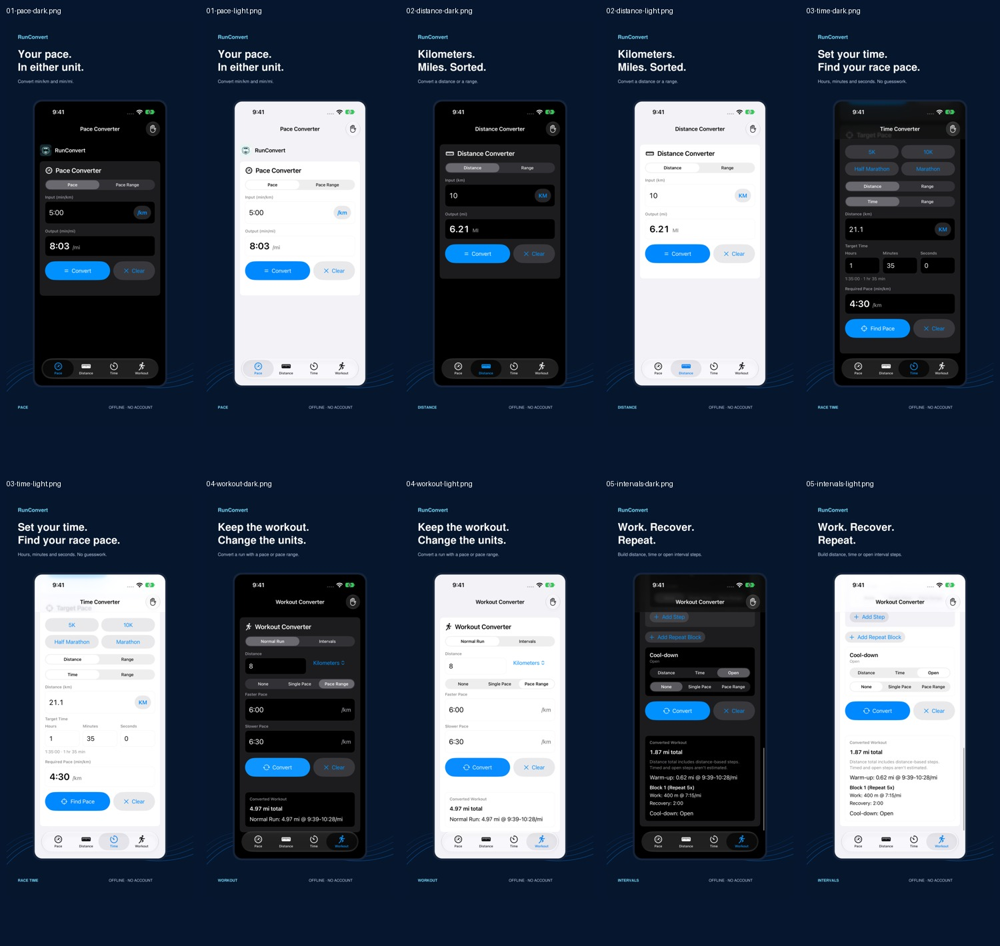

# RunConvert 1.0.2 media

Ten screenshot compositions: Pace, Distance, Target Pace, Normal Run and Intervals in light and dark modes. All native UI comes from the actual 1.0.2 app in iPhone 17 Simulator, captured by an XCTest method that asserts the displayed results. No app UI was generated or altered. Each design has medium (1206 x 2622) and large (1320 x 2868) RGB exports without transparency. Large exports re-render the vector composition around the same native capture. [Manifest](asset-manifest.json) retains native capture and output hashes.

Verified examples: 5:00/km -> 8:03/mi; 10 km -> 6.21 mi; Half Marathon 21.1 km in 1:35:00 -> 4:30/km; 8 km at 6:00-6:30/km -> 4.97 mi at 9:39-10:28/mi; 1 km warm-up plus five 400 m work steps -> 1.87 mi total, with timed recovery and open cool-down excluded from distance totals. The existing per-step rounding rule is preserved.

Rebuild with `python3 build_graphics.py` using ReportLab, PyMuPDF and Pillow. The `editable` folder contains vector PDF compositions. The `native` folder contains unchanged captures. `screenshots` and `screenshots-large` contain upload-ready exports.

Light and dark capture runs each passed 1 selected UI test with zero failures and runtime warnings. Release build smoke evidence is physical and separate. A first attempt to run the capture test in Release hit an enable-testing module configuration error; Debug capture runs passed. The app's Release build itself passed and ran on the iPhone.

[Apple screenshot specifications](https://developer.apple.com/help/app-store-connect/reference/app-information/screenshot-specifications) and [asset workflow](https://developer.apple.com/app-store/asset-best-practices/) checked October 11, 2026. Screenshots accompany the new version; upload/draft selection is separate from review/publication.

App Store Connect readback: all 20 assets uploaded and selected on version 1.0.2, 10/10 in both medium/large slots. Exact ordering and provider IDs are in the manifest. The version remains Prepare for Submission; assets are not yet reviewed or public.
