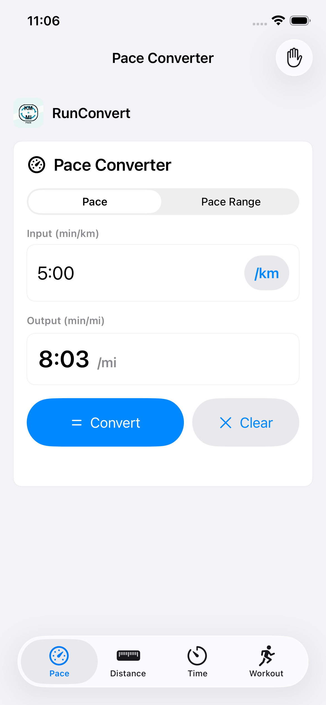
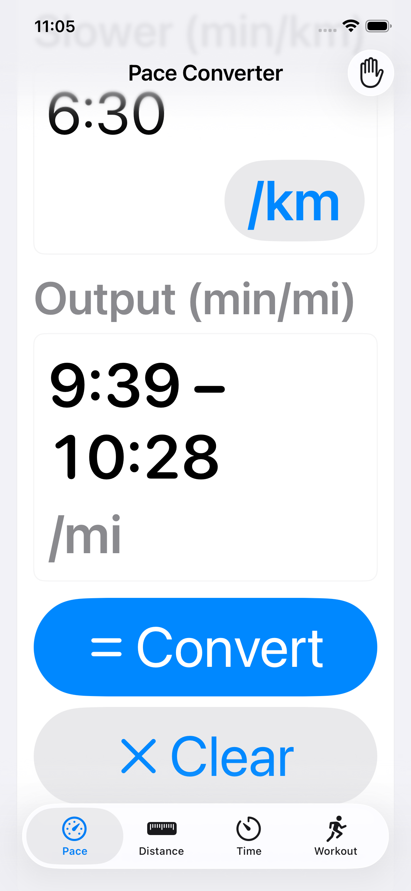
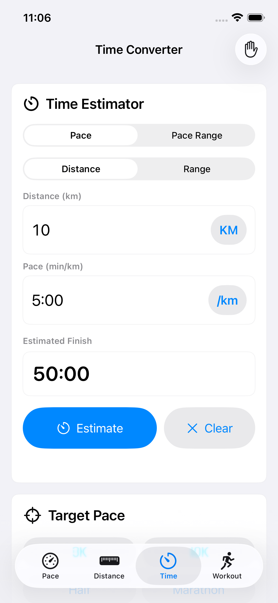
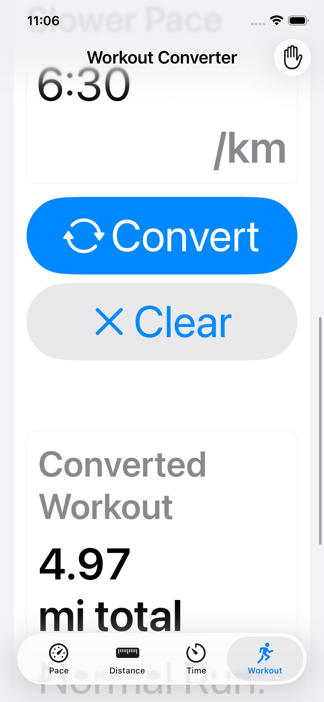

# RunConvert local UI review

Final source tested on iPhone 17e with iOS 26.5: 15 tests passed, no failures or warnings. Additional iPhone 17/iOS 27 testing and motion checks are recorded in [the implementation notes](README.md).

## Standard text

The existing primary/secondary action styles remain, with the RunConvert wordmark above the Pace card.

## Largest accessibility text

Both endpoints remain complete, the unit has room, and Convert/Clear use the full available width.

## Time and Workout

These are Simulator captures of local changes. No app release or physical-device install was performed.
