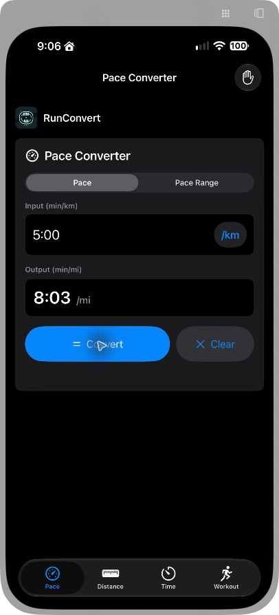
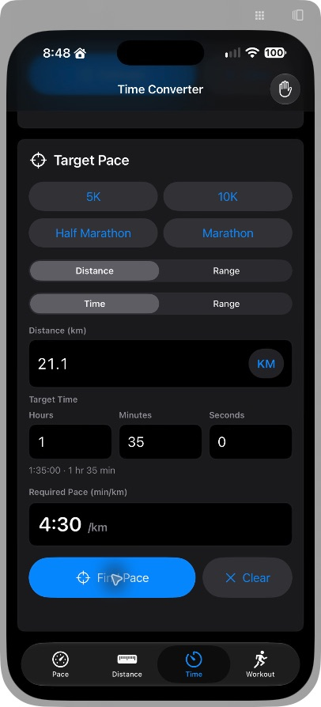
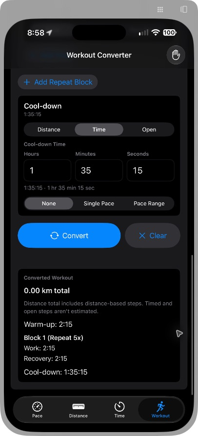

# Physical iPhone verification, October 11, 2026

RunConvert installed and launched on AIS17PM, iOS 27.0.1. Computer Use through iPhone Mirroring exercised 51 normal-size mode/unit checkpoints from the Simulator matrix: Pace and Distance singles/ranges, all Time Estimator and Target Pace combinations, half/full marathon targets, all Normal Run efforts, interval distance units/efforts/output units, all four timed/open roles, add/role/delete/repeat editing, validation and focus removal. Representative equivalent values were used; these were visual checks rather than a physical XCTest run. [Complete matrix and evidence manifest](physical-iphone-2026-10-11.json).

Hours, Minutes and Seconds, the live duration descriptions, unit conversions, totals, and visible Done dismissal passed. Mirroring uses Mac hardware-keyboard input; it does not prove the physical onscreen numeric keyboard. Simulator keyboard tests remain the proof for that channel.

The owner stopped the largest-text phone check. Only the app's launch argument had been changed, never the iPhone Settings. Normal-size launch was independently restored and checked. The existing largest-text Simulator tests remain passed.

The same source was rebuilt in Release as 1.0.2 (3), installed and launched, and smoke-checked with 5:00/km -> 8:03/mi. Zero build warnings or errors. Bundle identity com.aisolo.runconvert, minimum iOS 17.0, iPhone only, non-exempt encryption false were read from the built app.

Raw computer-use captures and launch/build evidence are retained outside Git under Library/Developer/RunConvertReleases/2026-10-11-1.0.2-build-3/iphone-audit.
