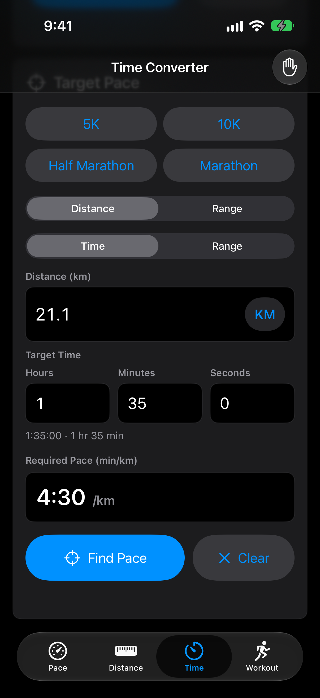
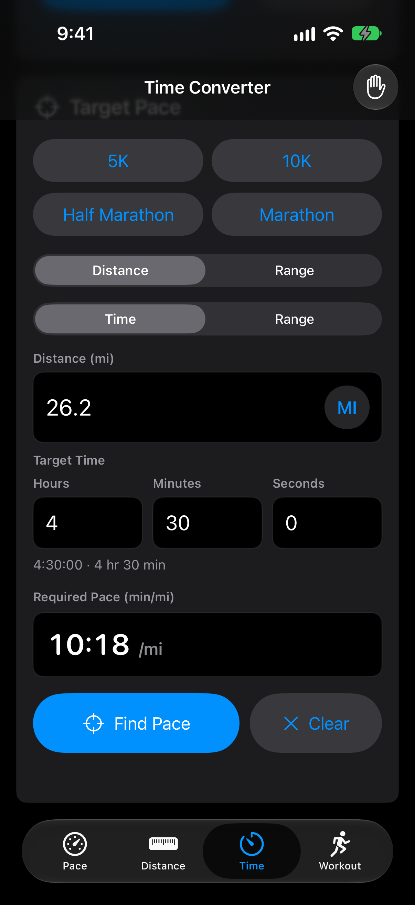
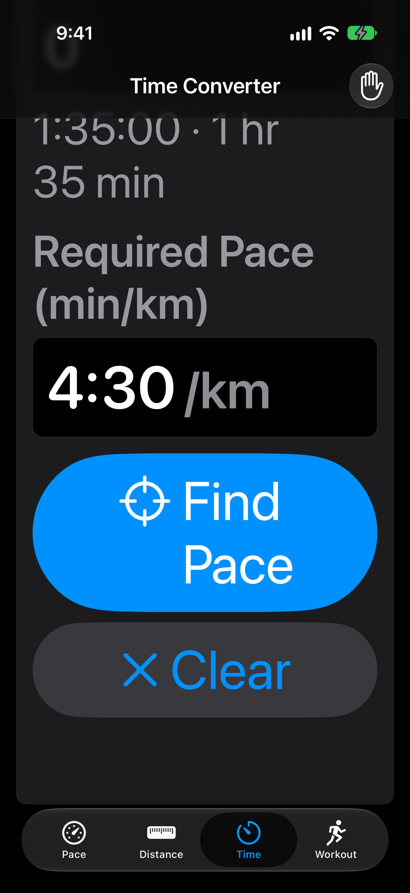
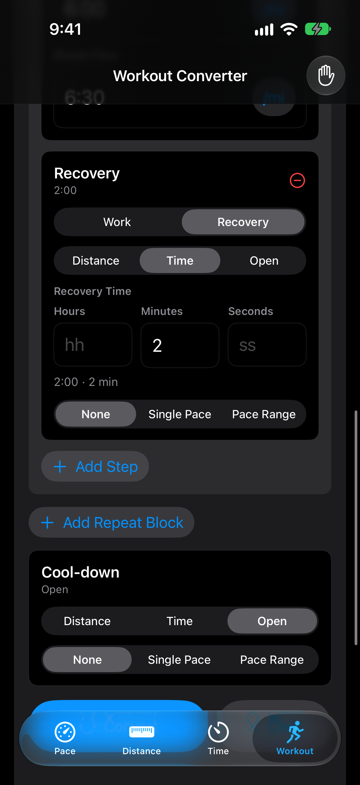

# RunConvert time-entry review

Actual Simulator captures of local changes. [Audit matrix and checks](README.md).

## Half marathon in 1 hour 35 minutes

Hours 1, Minutes 35, Seconds 0. The preview confirms 95 minutes; the existing 21.1 km preset gives 4:30/km.

## Marathon in miles

The existing 26.2 mi preset at 4 hr 30 min gives 10:18/mi.

## Largest accessibility text

## Timed recovery

Duration components also apply to interval steps; an omitted Hours or Seconds part remains zero.

No physical-device install or release was performed.
